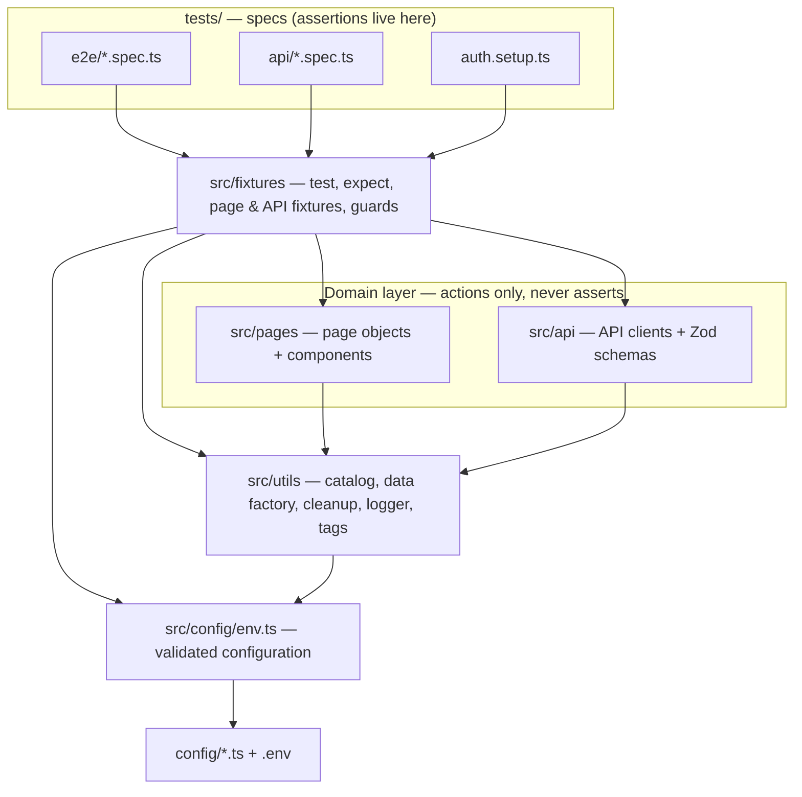
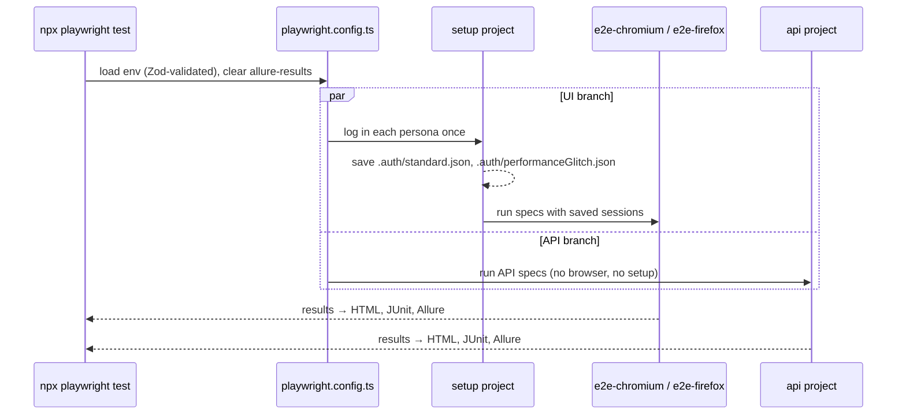

# Framework guide

This guide explains how the framework is built and why. Read it once before making structural changes. For step-by-step tasks see the [how-to guides](how-to.md); for exact names and values see the [reference](reference.md).

## Design goals

1. **Tests read like specifications.** A spec describes user intent and expected outcome; mechanics live elsewhere.
2. **Zero flakiness by construction.** No fixed sleeps anywhere; every wait is on a concrete condition.
3. **Tests are independent.** Each test gets a fresh browser context and creates and cleans up its own data, so tests can run in any order and in parallel.
4. **One codebase, many environments.** Environment differences are configuration, never code branches.
5. **Rules are enforced, not just written.** Where possible a convention is backed by a lint rule or a type.

## Architecture



Dependencies point one way: specs → fixtures → page objects / API clients → utilities → configuration. Nothing in `src/` imports from `tests/`.

## How a test run flows



The `setup` project must pass before any UI spec runs. If login is broken, you get one clear failure instead of dozens of confusing ones.

## Configuration

Settings come from two kinds of source:

- **Profiles** in `config/` hold non-secret settings. `default.ts` is complete; `qa.ts`, `staging.ts` and `prod.ts` contain only what differs.
- **Environment variables** (from the shell, CI or `.env` files) hold secrets and allow one-off overrides.

`src/config/env.ts` merges them, validates the result with a [Zod](https://zod.dev) schema and exports a frozen `env` object. Validation happens once, at startup: a missing password or a malformed URL stops the run immediately with a message naming the problem, instead of failing deep inside a test.

Code reads settings only through `env`, never through `process.env`, so every setting has one type, one default and one validation rule. The exact layering order and every variable are listed in the [reference](reference.md#configuration-precedence). See also [ADR-0002](adr/0002-validated-layered-configuration.md).

## Authentication: log in once per persona

Logging in through the UI in every test is slow and makes every test depend on the login page. Instead:

1. The `setup` project (`tests/auth.setup.ts`) logs in **once per persona** and saves the browser session (cookies and local storage) to `.auth/<persona>.json`.
2. Every UI test starts a fresh browser context **pre-loaded with that session**. Which session is chosen by the `role` fixture option:

```ts
test.use({ role: 'performanceGlitch' }); // a different persona
test.use({ role: 'anonymous' }); // logged out — for testing the login page itself
```

The default is `'standard'`. The login page is still tested — in `login.spec.ts`, with `role: 'anonymous'` — but no other test pays for it. See [ADR-0001](adr/0001-authenticate-via-saved-sessions.md).

## Fixtures: the spec's toolbox

Playwright [fixtures](https://playwright.dev/docs/test-fixtures) are named dependencies a test asks for in its parameter list; Playwright builds them before the test and tears them down after. All of this project's fixtures are combined in `src/fixtures/index.ts`:

| File               | Provides                                                                                    |
| ------------------ | ------------------------------------------------------------------------------------------- |
| `page.fixtures.ts` | `role`, the session-loading `storageState`, every page object, `seedCart`                   |
| `api.fixtures.ts`  | an API connection and admin token (one per worker), API clients, `cleanup`, `createBooking` |
| `matchers.ts`      | extra assertions: `toHaveStatus`, `toMatchSchema`                                           |
| `index.ts`         | merges the above and adds the automatic `@destructive` guard                                |

Because every spec imports `test` from `@fixtures/index`, cross-cutting behaviour — authentication, cleanup, the production guard — applies everywhere without each test opting in. A lint rule forbids importing `test` from `@playwright/test` in specs so this cannot be bypassed by accident. Full list: [reference — fixtures](reference.md#fixtures).

## Page Object Model

Page objects translate _user intent_ ("add the backpack to the cart") into _browser mechanics_ (which button, which locator).

- **Pages** extend `BasePage` and declare a `path` and a `readyLocator` — an element whose visibility proves the page is usable. `goto()` navigates and waits for it; `waitUntilReady()` waits for it after an action navigated there.
- **Components** extend `BaseComponent` and receive a `root` locator; all their locators are found inside that root. This is what lets one `ProductCardComponent` class represent any of the six product cards on the inventory page, or a row in the cart.
- **Page objects never assert.** They return locators, data or themselves; specs decide what is correct. This keeps one page object usable by both positive and negative tests, and keeps the expected behaviour visible in the spec. A lint rule bans importing `expect` under `src/pages` and `src/api`. See [ADR-0003](adr/0003-page-objects-and-clients-never-assert.md).

### Choosing locators

Prefer what a user perceives, in this order:

1. `getByRole` — buttons, links, headings, navigation (`getByRole('button', { name: 'Checkout' })`)
2. `getByPlaceholder` / `getByLabel` — form fields
3. `getByText` — visible text
4. `getByTestId` — elements with no accessible handle; this project maps it to SauceDemo's `data-test` attribute

User-facing locators survive markup refactors and fail when the user experience actually changes, which is exactly when a test should fail.

### Waiting without sleeping

Playwright actions (`click`, `fill`) wait for the element to be visible, enabled and stable. Assertions such as `toHaveText` and `toHaveCount` retry until they pass or time out. So instead of _"wait 2 seconds, then check"_, a test states the end state and Playwright waits for it. `waitForTimeout`, `force: true` and `waitForLoadState('networkidle')` are lint errors.

## API layer

Each API client offers **two methods per endpoint**:

| Method             | Returns               | Use it when                                                                             |
| ------------------ | --------------------- | --------------------------------------------------------------------------------------- |
| `createResponse()` | raw `APIResponse`     | the test is about the HTTP behaviour itself — status codes, error bodies, auth failures |
| `create()`         | typed, validated data | the call is a means to an end — setting up data, reading it back                        |

The typed method insists on a 2xx status and validates the body against a Zod schema in `src/api/schemas/`. If the API changes shape, the test fails at the call with a precise message ("`totalprice`: expected number, received string") instead of later with a confusing `undefined`. See [ADR-0004](adr/0004-two-layer-api-clients.md).

## Test data lifecycle

State that a test needs but is not testing is created **without the UI**, and anything created is **removed afterwards**:

- `seedCart(...products)` writes the cart straight into SauceDemo's browser storage and opens the cart page — no clicking through the inventory.
- `createBooking()` creates a booking through the API and registers its deletion.
- `cleanup.register(label, fn)` registers any other teardown. Registered tasks run after the test, **last-in-first-out**, **whether the test passed or failed**. Every task runs even if an earlier one fails; failures are reported together.

This keeps tests fast, independent of each other, and safe to run against shared environments. See [ADR-0005](adr/0005-seed-state-and-clean-up.md).

## Environments and safety

`TEST_ENV` selects a profile: `qa` (default), `staging` or `prod`. Profiles change timeouts, retries, parallelism and log level — not test code.

Tests that change data carry the `@destructive` tag. When the active profile sets `allowDestructive: false` (as `prod` does), an automatic fixture skips them with a visible reason, so a production smoke run can never create or delete real records — even if someone forgets the `--grep-invert` flag.

## Reporting and artifacts

Every run writes:

- **Playwright HTML report** (`reports/html`, open with `npm run report`) — the primary debugging tool.
- **JUnit XML** (`reports/junit/results.xml`) — for CI systems.
- **Allure results** (`allure-results/`, render with `npm run allure:generate`) — trend-friendly report with environment details.

For failed tests, Playwright keeps a **trace**, a **screenshot** and a **video** in `test-results/`. Passing tests keep nothing, so artifacts stay small. See [how to debug a failing test](how-to.md#debug-a-failing-test).

## Quality gates

`npm run verify` must pass before a change is merged. It runs:

| Check          | Catches                                                                                                                              |
| -------------- | ------------------------------------------------------------------------------------------------------------------------------------ |
| `tsc --noEmit` | type errors (strict mode, including unchecked index access)                                                                          |
| ESLint         | hard waits, `force: true`, `networkidle`, focused tests, floating promises, assertions in page objects, specs bypassing the fixtures |
| Prettier       | formatting drift                                                                                                                     |
| `docs:check`   | broken relative links and anchors in the Markdown docs                                                                               |

## Known quirks of the test targets

These are behaviours of the demo applications, not bugs in the framework. Tests assert them as they are.

- SauceDemo's side-menu entries (All Items, Logout, Reset App State) are **buttons**, not links; only About is a link.
- Restful-Booker answers a successful `DELETE` with **201**, a bad login with **200** and `{ "reason": "Bad credentials" }`, and a delete of a missing booking with **405**.
- Restful-Booker is a public, shared service: other people's data appears in list results, and the service resets periodically. Tests therefore use unique names and never assume an empty system.
